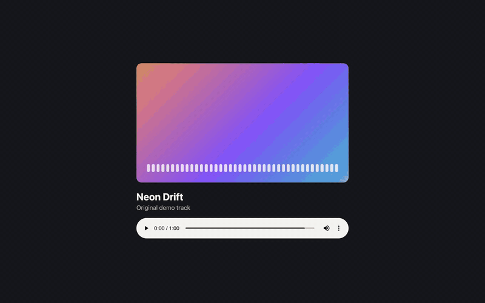
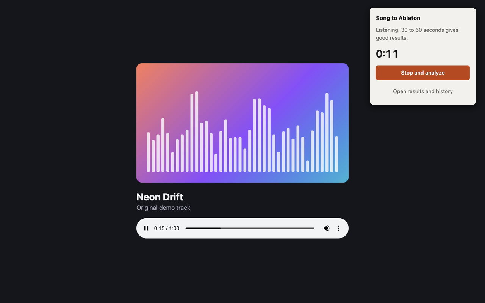
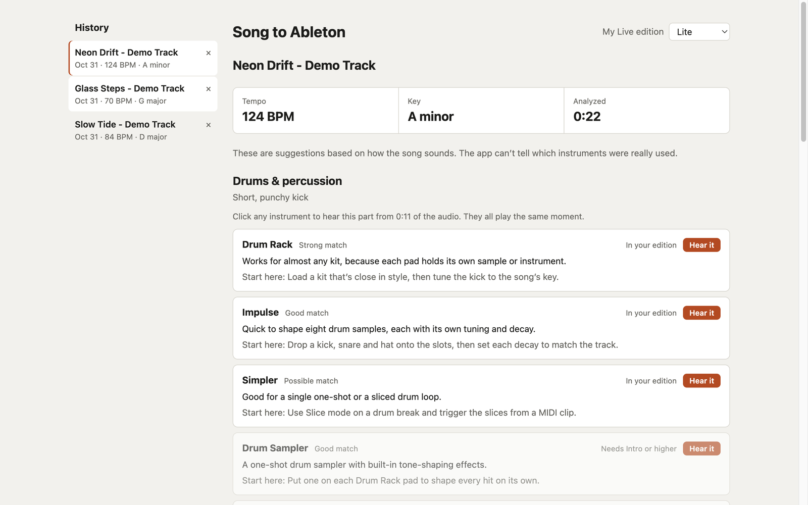
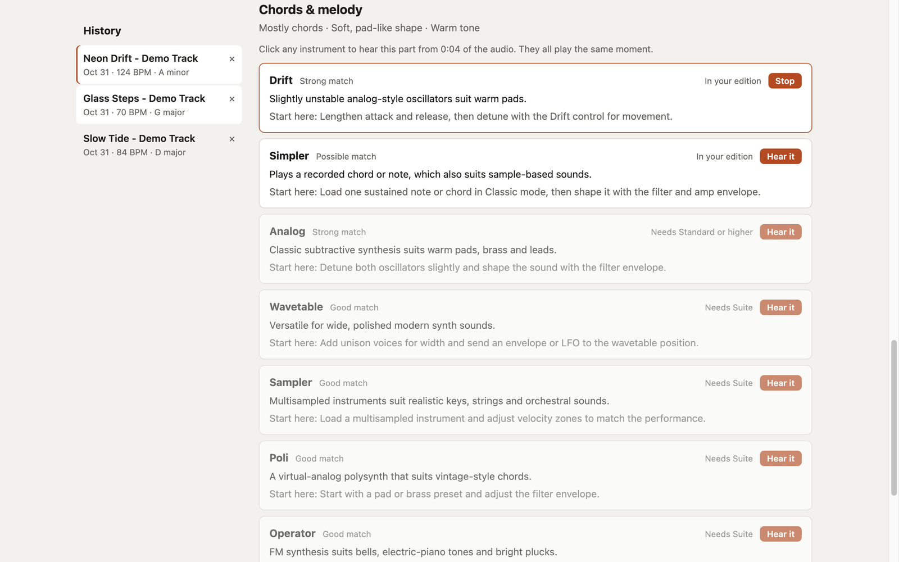
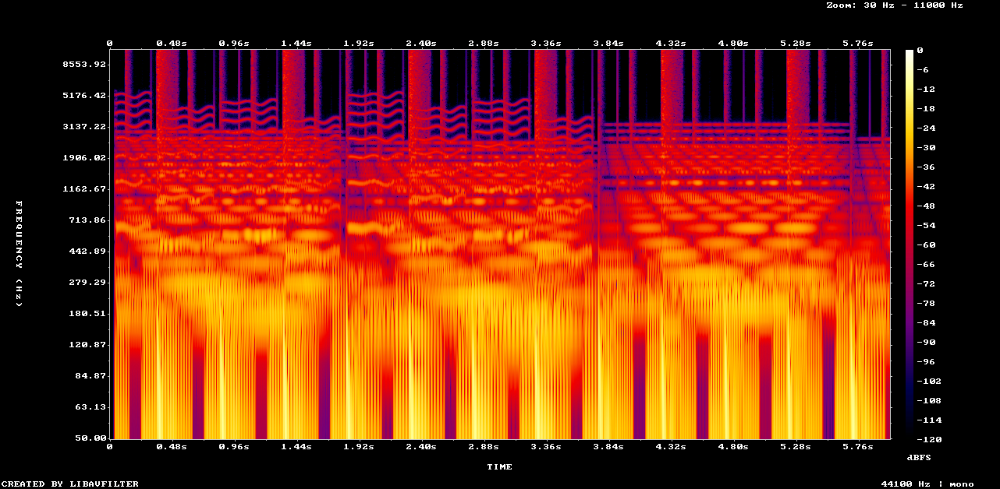

# Song to Ableton

A browser extension that listens to a song playing in a tab and suggests Ableton Live instruments that could recreate its sound.

It's a great tool for beginners like myself who are trying to learn music production. Pick a song you love and see where to start in Ableton.

[](docs/demo.mp4)

[Watch the demo with sound](docs/demo.mp4). It runs the real extension on an original demo track. Listening is sped up, and the popup is placed over the song page.

Everything runs on your computer and nothing is uploaded. Once the analysis finishes, the audio is discarded except for one 5-second preview clip per layer. Results and clips are saved in the extension's local storage, and they're deleted if you remove the extension.

## Screenshots

**Listen to any tab.** Play a song, then start listening from the toolbar.



**See what could make that sound.** Each song gets its tempo and key, plus instruments for each layer, marked by whether your Live edition includes them.



**Hear the part you're looking at.** Click an instrument to play the moment its layer stands out.



## Install

This works in Chrome, Brave and other Chromium browsers.

1. Open `brave://extensions` in Brave, or `chrome://extensions` in Chrome.
2. Turn on **Developer mode**.
3. Click **Load unpacked** and choose this project's `extension` folder.
4. Pin **Song to Ableton** to your toolbar.

## Use

1. Play a song in a tab and let any ads finish.
2. Click the extension, then **Start listening**. Clicking it fresh on that tab matters, because the browser only grants capture for the tab you clicked it on.
3. Let it listen for 30 to 60 seconds, then click **Stop and analyze**. It stops by itself after 5 minutes.
4. The results open in a new tab. Choose your Live edition at the top to sort instruments you own first.

Click any instrument in the results to hear the moment its layer stands out most, at the original audio quality, with the other parts turned down to a quiet background. Every instrument in a layer plays the same clip, because the analysis finds layers, not individual instruments.

## History

The results page keeps your last 25 songs in a list, so you can click between them or delete any you don't want. Songs are named from the tab title. To see them any time, click the extension and choose **Open results and history**. Preview clips take up the most space, so only the 5 newest songs keep theirs. Older songs keep everything else.

## Updating

When the code changes, the popup asks you to click the reload arrow on the extension's card before it will listen again. Raise `version` in `manifest.json` with each change, or the popup won't notice.

## How it works

The extension doesn't identify instruments, and there's no machine learning. It uses classic signal processing to describe how the song sounds, then a rule table to suggest Ableton instruments that can make a similar sound. Everything runs in the browser, with no dependencies.

### 1. Turn the audio into a spectrogram

The tab's audio is mixed to mono and resampled to 22,050 Hz. A short-time Fourier transform (2,048-sample window, 512-sample hop) then turns it into a spectrogram, a picture of the sound. Time runs left to right, pitch runs bottom to top, and brightness shows how loud each pitch is at each moment.



In this spectrogram of a demo track:

- **Drums:** the tall vertical stripes at the top are the snare and hi-hats. A drum hit covers many pitches for an instant.
- **Bass and kick:** the bright blocks along the bottom are the low notes, pulsing with the beat.
- **Chords:** the horizontal bands in the middle are notes held over time.
- **Lead:** the wavy lines near the top left are a lead synth with vibrato.

### 2. Separate held notes from drum hits

Held notes make horizontal lines and drum hits make vertical streaks. Median filtering along each direction splits the spectrogram into a harmonic layer and a percussive layer. This technique is called harmonic/percussive separation.

### 3. Measure each layer

- **Tempo:** autocorrelation of the drum onsets finds the beat gap that repeats most.
- **Key:** the 12 note classes are totalled and compared against standard major and minor key profiles (Krumhansl–Kessler).
- **Character of each layer:** attack, decay and sustain, brightness, how rich the overtones are, how many notes sound at once, and how much the sound changes over time.

### 4. Match instruments with rules

A hand-written table in `catalog.js` first turns the measurements into labels, such as pluck, pad, bright, chords or evolving. Each Ableton instrument then gets a score for each layer from those labels:

| If the sound is… | Instrument | Score |
| --- | --- | --- |
| Chords, not bright, not a pad | Electric | 0.8 |
| Bright and plucky | Collision | 0.65 |
| Evolving | Wavetable | 0.9 |
| A buzzy bass | Analog | 0.8 |

A score of 0.75 or more shows as a strong match, and 0.55 or more as a good match. Scores of 0.4 or below are hidden. Every suggestion comes with a reason and a place to start, and results are sorted by the Live edition you choose.

### 5. Make the preview clips

For each layer, the extension finds the 5 seconds where it's loudest compared to the rest of the mix. It then turns the other frequency ranges down to about 10% volume, so that part stands out.

### Where the code is

All of it is in `extension/analysis`:

- `dsp.js`: resampling, the Fourier transform and harmonic/percussive separation.
- `analyze.js`: tempo, key and the measurements for each layer.
- `catalog.js`: the instruments, which Live edition includes each one, and the matching rules.
- `preview.js`: the preview clips.

## Limits

- Results are suggestions. Audio alone can't show which instruments were actually used.
- Layers are split by frequency and sound shape, not true stem separation. Vocals can affect the chords and melody results, and previews bring a part forward rather than fully isolating it.
- Tempo can read as half or double the felt speed, so slow and fast results show both options.
- Paid or protected services may block capture or return silence.

## Test

Requires Node 20 or later.

```bash
node --test tests/
```
