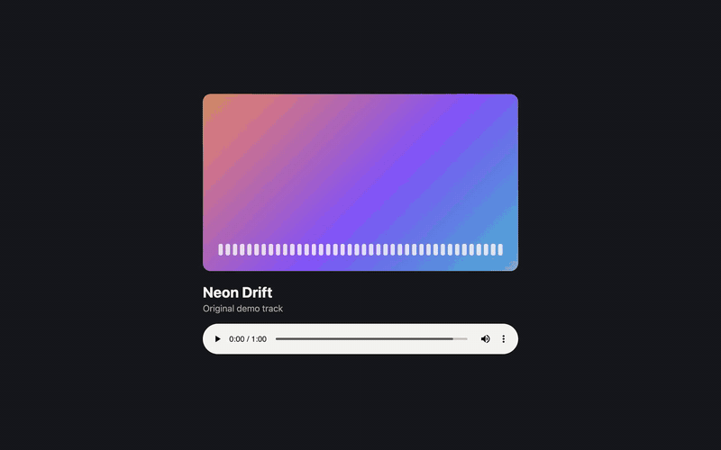
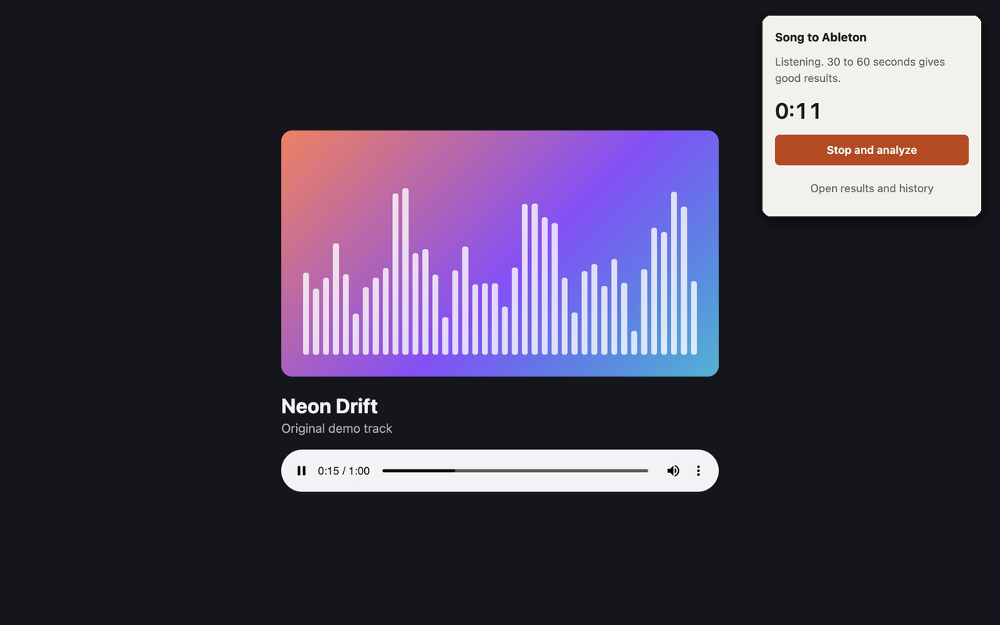
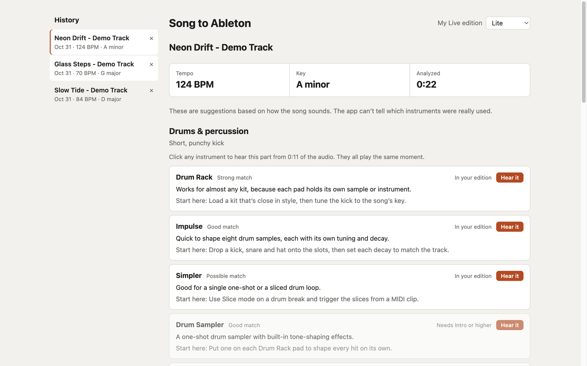
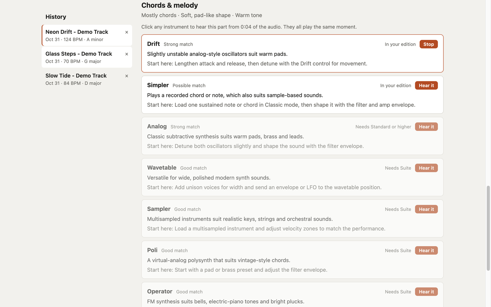

# Song to Ableton

A browser extension that listens to a song playing in a tab and suggests Ableton Live instruments that could recreate its sound.

It's a great tool for beginners like myself who are trying to learn music production. Pick a song you love and see where to start in Ableton.

[](docs/demo.mp4)

[Watch the demo with sound](docs/demo.mp4). It runs the real extension on an original demo track. Listening is sped up, and the popup is placed over the song page.

Everything runs on your computer and nothing is uploaded. Once the analysis finishes, the audio is discarded except for one 5-second preview clip per layer. Results and clips are saved in the extension's local storage, and they're deleted if you remove the extension.

## Screenshots

**Listen to any tab.** Play a song, then start listening from the toolbar.



**See what could make that sound.** Each song gets its tempo and key, plus instruments for each layer, marked by whether your Live edition includes them.



**Hear the part you're looking at.** Click an instrument to play the moment its layer stands out.



## Install

This works in Chrome, Brave and other Chromium browsers.

1. Open `brave://extensions` in Brave, or `chrome://extensions` in Chrome.
2. Turn on **Developer mode**.
3. Click **Load unpacked** and choose this project's `extension` folder.
4. Pin **Song to Ableton** to your toolbar.

## Use

1. Play a song in a tab and let any ads finish.
2. Click the extension, then **Start listening**. Clicking it fresh on that tab matters, because the browser only grants capture for the tab you clicked it on.
3. Let it listen for 30 to 60 seconds, then click **Stop and analyze**. It stops by itself after 5 minutes.
4. The results open in a new tab. Choose your Live edition at the top to sort instruments you own first.

Click any instrument in the results to hear the moment its layer stands out most, at the original audio quality, with the other parts turned down to a quiet background. Every instrument in a layer plays the same clip, because the analysis finds layers, not individual instruments.

## History

The results page keeps your last 25 songs in a list, so you can click between them or delete any you don't want. Songs are named from the tab title. To see them any time, click the extension and choose **Open results and history**. Preview clips take up the most space, so only the 5 newest songs keep theirs. Older songs keep everything else.

## Updating

When the code changes, the popup asks you to click the reload arrow on the extension's card before it will listen again. Raise `version` in `manifest.json` with each change, or the popup won't notice.

## How it works

The analysis runs in `extension/analysis` with no dependencies:

- `dsp.js` splits the audio into sustained notes and drum hits using a technique called harmonic/percussive separation.
- `analyze.js` measures tempo, key and the character of each layer.
- `preview.js` finds each layer's standout moment and rebuilds it as a short clip.
- `catalog.js` lists the Ableton instruments, which edition includes each one, and the rules that match them to a layer.

## Limits

- Results are suggestions. Audio alone can't show which instruments were actually used.
- Layers are split by frequency and sound shape, not true stem separation. Vocals can affect the chords and melody results, and previews bring a part forward rather than fully isolating it.
- Tempo can read as half or double the felt speed, so slow and fast results show both options.
- Paid or protected services may block capture or return silence.

## Test

Requires Node 20 or later.

```bash
node --test tests/
```
